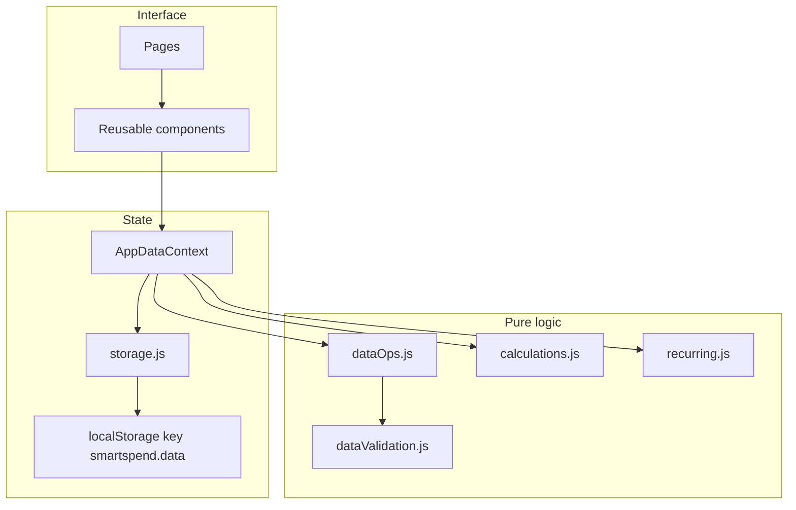
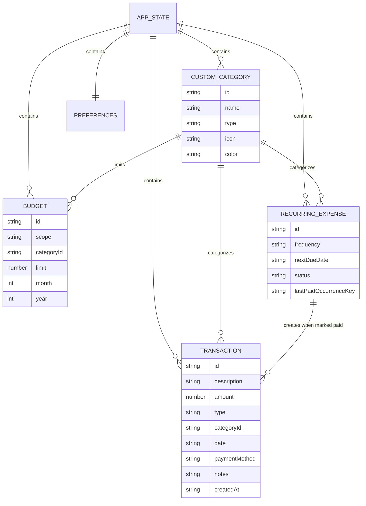

# SmartSpend — Smart Expense & Budget Manager

SmartSpend is a local personal-finance web app for tracking income and expenses, monthly budgets, and recurring payments. All data stays in the browser. There is no account, backend, or paid service.

## Problem statement

Household spending is easy to lose track of when it is split across cash, UPI, cards, and subscriptions. Spreadsheets work, but they rarely show budget progress, upcoming bills, and month-over-month change in one place. SmartSpend keeps those records on the device, calculates totals from the saved transactions, and lets the user export a backup they control.

## Key features

- Dashboard totals for income, expenses, remaining overall budget, and net savings, plus month-over-month spending, budget progress, recent transactions, and upcoming recurring items.
- Charts for daily spending, category breakdown, and income versus expenses. Values come from stored transactions.
- Transaction add, edit, delete (with confirmation), search, combined filters, sort, pagination, and CSV export of the filtered list.
- Built-in income and expense categories, plus custom categories with an icon and color. Deleting a custom category that is in use requires a replacement category.
- Monthly overall budget and category budgets. Progress uses expense transactions only. The overall cap is separate from the sum of category limits.
- Warning at 80% of a limit (including exactly 100%) and an over-budget state when spending exceeds the limit.
- Recurring expenses on weekly, monthly, or yearly schedules. A payment is recorded only when the user marks it paid. The same occurrence cannot be paid twice, and loading the app does not create transactions.
- Reports for trends, payment methods, top categories, highest expenses, savings, budget utilization, and month-over-month change, with CSV export.
- Settings for currency (INR by default), date format, dashboard month behavior, light and dark theme, JSON backup and restore, sample data, and a full reset.
- Optional sample data for the current month and the previous five months. It is merged by id and never replaces existing user rows.

## Technology stack

- React 19 and Vite 7
- React Router 7
- JavaScript (ES modules, JSX). No TypeScript.
- CSS custom properties. No Tailwind CSS.
- Recharts 2 for charts
- Lucide React for icons
- date-fns for calendar math
- PapaParse for CSV
- Vitest, jsdom, and React Testing Library
- `localStorage` for persistence

## Screenshots

Screenshots are not committed in this repository. The pages below were exercised in a local browser against the Vite dev server, with sample data loaded and one extra expense added by hand:

- Dashboard with summary cards, budget progress, and charts
- Transactions list, search, and delete confirmation
- Budgets with on-track, warning, and over-budget states
- Recurring expenses, including mark-as-paid moving the next due date
- Reports built from the saved transactions
- Settings, including the dark theme

## Architecture

UI components read and update one React context. The context holds the current state and calls pure functions for validation, calculations, and record changes. Those functions do not touch the DOM. After a successful change, the provider writes the whole state document to `localStorage`.



Money is summed in integer cents, then converted back to a two-decimal amount, so values such as `0.1 + 0.2` do not drift. Dates are stored as local `YYYY-MM-DD` strings so a timezone offset cannot shift a transaction to the previous day.

## Logical data model

These are records inside one JSON document, not database tables.



Built-in categories live in code (`src/utils/categories.js`) and are merged with `customCategories` at read time. A budget with `scope: "overall"` has no category. A category budget uses `scope: "category"` plus `categoryId`.

## Folder structure

```text
src/
  components/
    layout/        Sidebar, header, mobile drawer, app shell
    common/        Buttons, modal, fields, empty state, pagination
    dashboard/     Summary cards and charts
    transactions/  Form, filters, table, and mobile cards
    budgets/       Budget form, cards, and list
    recurring/     Recurring form and list
    reports/       Analytics layout
    settings/      Category editor
  pages/           One page per navigation section
  context/         AppDataContext provider
  hooks/           Generic useLocalStorage hook
  utils/           Calculations, dates, currency, CSV, validation, storage
  styles/          Tokens, global CSS, component CSS
  test/            Vitest setup
public/            Favicon, Netlify redirect
```

## Installation and setup

Requirements: Node.js 20 or newer and npm.

```bash
npm install
```

If `npm install` fails while the project folder is inside OneDrive, pause sync or move the folder, delete `node_modules` and `package-lock.json`, then install again. A file lock can interrupt the esbuild binary.

## Commands

| Command | What it does |
| --- | --- |
| `npm run dev` | Starts the Vite dev server |
| `npm test` | Runs the Vitest suite once |
| `npm run test:watch` | Re-runs tests while files change |
| `npm run build` | Writes a production bundle to `dist/` |
| `npm run preview` | Serves the production bundle locally |

Open the URL Vite prints, usually `http://127.0.0.1:5173/`.

## Testing

`npm test` runs 30 tests in three files:

- `src/utils/finance.test.js` — transaction add, edit, and delete; invalid amounts; monthly totals across the year boundary; month-over-month comparison; budget warning, over-budget, and zero-limit cases; expense-only budget usage; duplicate budgets; combined filters and sort; CSV export including an empty list; recurring anchor dates, weekly counts, duplicate payment prevention, and paused schedules; backup validation; category reassignment; sample data.
- `src/utils/storage.test.js` — empty storage, corrupted JSON, a newer schema that must not be overwritten, round-trip save and load, provider persistence, and no automatic recurring payments on load.
- `src/components/transactions/TransactionForm.test.jsx` — inline validation that keeps typed input, and a single submit.

Latest run during development: 3 files, 30 tests, all passed.

## LocalStorage data model

One key, `smartspend.data`, holds schema version 1:

```json
{
  "schemaVersion": 1,
  "transactions": [],
  "budgets": [],
  "recurringExpenses": [],
  "customCategories": [],
  "preferences": {
    "currency": "INR",
    "dateFormat": "dd MMM yyyy",
    "dashboardMonth": "current",
    "theme": "light",
    "displayName": "My finances"
  },
  "meta": {
    "demoPromptSeen": false,
    "demoLoaded": false,
    "lastViewedMonth": null
  }
}
```

If the JSON cannot be parsed, or saved records fail validation, the bad payload is copied to `smartspend.data.invalid` and the app starts from defaults (or from the valid records it could keep). If `schemaVersion` is newer than this build, the app shows the data as read-only and does not overwrite it.

Preferences also support USD, EUR, and GBP through `Intl.NumberFormat`. Currency is a display choice. Amounts are stored as numbers, not converted between currencies.

Each recurring expense stores `lastPaidOccurrenceKey` as `recurringId:dueDate`. Mark as paid refuses to create another expense when that key is already set for the current due date.

## Design decisions and limitations

- Data never leaves the browser. It does not sync between devices, browsers, or private windows. Clearing site data deletes it unless a JSON backup was exported.
- The overall monthly budget is a separate spending cap. Category limits are not added together to produce that cap. The Budgets page states this in the page copy.
- Recurring items are not posted on startup. The user marks each occurrence paid. A short lock also ignores a second click on the same item within 600ms.
- Monthly and yearly schedules keep an anchor day. 31 January becomes 28 February, then 31 March. 29 February uses 28 February in non-leap years and returns to 29 February in a leap year.
- A category budget at exactly 100% is a warning, not an overrun. An overrun is spending greater than the limit. A limit of zero is treated as invalid.
- Recharts 2.15.4 is pinned because the charts use that API. The package is deprecated upstream. The production JavaScript bundle is large (about 870 KB before gzip, about 250 KB gzipped) because charts and icons are in one chunk. That size was observed from `vite build`; it is not a measured page-load time.
- Charts, dialogs, and form controls follow the light and dark token set. Dark mode was checked on Reports and Settings in the local browser.
- There is no authentication, multi-user support, or server backup.

## Future enhancements

- Split the chart library into a separate chunk so the first screen downloads less JavaScript.
- Move to a maintained chart release when the component API is updated.
- Optional encrypted backup file, still without a hosted account.
- A monthly review that lists uncategorized or unbudgeted spending.

## Deployment

The app is a static SPA. `npm run build` produces `dist/`.

- **Netlify:** publish `dist`. `public/_redirects` sends every path to `index.html` so React Router routes work on refresh.
- **Vercel:** `vercel.json` rewrites all paths to `index.html`. Set the output directory to `dist`.
- **GitHub Pages:** project sites do not apply those rewrite files. Use a host that supports an SPA fallback, or add a `404.html` copy of `index.html` and a base path if the site is not served from the domain root. This repo does not set a Vite `base`, so it expects to be served from `/`.

No API keys or environment variables are required.

## Resume project description

Built SmartSpend, a responsive personal finance app in React and Vite that tracks income, expenses, monthly budgets, and recurring bills entirely in browser storage. Separated validation and money math from the UI, prevented duplicate budget rows and duplicate recurring payments, and covered the calculations with Vitest.

## Interview questions

**Architecture**

- Why is financial math kept outside React components?
- What would break if every component read `localStorage` itself?
- How would you add a sync API later without rewriting the pages?

**React state**

- Why does the provider keep a ref of the latest state while also calling `setState`?
- How does React Strict Mode affect id generation and one-time effects?
- Where should a toast live so every page can show one?

**Calculations**

- Why sum money in integer cents?
- How do you compare this month with the previous month when the previous month is January?
- Why must the overall budget stay separate from the sum of category budgets?

**LocalStorage**

- What do you do when saved JSON is corrupt?
- Why refuse to overwrite data whose schema version is newer?
- How do you stop a sample-data load from deleting transactions the user already entered?

**Validation**

- Which rules belong in the form, and which belong in the pure operation functions?
- How do you delete a category that transactions already use?
- How do you stop the same recurring occurrence from creating two expenses?

**Edge cases**

- What should happen for a budget limit of zero?
- How do you schedule a monthly bill that starts on 31 January?
- What should a CSV export contain when the current filter matches nothing?
